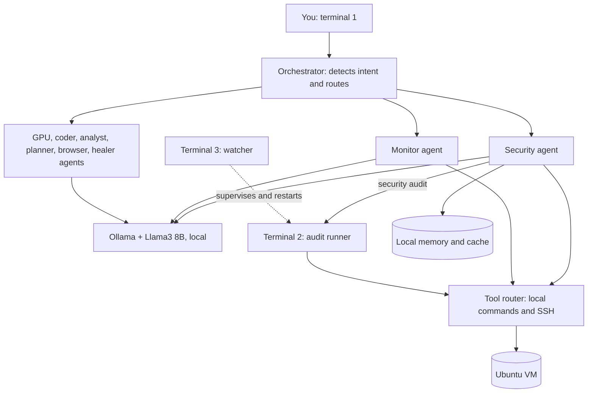

# ECE-Senior-Design-Project-2026

Local AI Agent Using an Open-Source LLM. This is a free, fully local, private multi-agent AI that
checks the security of Linux (Ubuntu) computers over SSH.

Senior Design Project | Computer Engineering | Cal Poly Pomona | Fall 2026

## Overview
- The agent runs completely on the user's own computer using Ollama and Llama 3 8B. There is no cloud and no paid API.
- Multiple agents (security, monitoring, GPU, code, analysis, planning, browsing and self-healing) all share one tool router.
- Security audits are matched to frameworks like CIS, NIST CSF, ISO 27001, SOC 2, PCI DSS and HIPAA.
- Long audits run in their own terminal. A third terminal watches the audit and restarts it if it fails.

## What it does
| You type | What happens |
|---|---|
| `run security audit` | Opens two new terminals. One runs the audit and the other watches it and restarts it if it fails. The main terminal stays free to use. |
| `security audit 192.168.1.50` | Audits a different computer. The results are saved for each computer. |
| a plain question, like "what is a firewall" | The local model answers it directly. |
| a monitoring request | Checks the VM's performance, ports, users and logins over SSH. |
| a GPU request | Measures the GPU and draws a graph of utilization, memory, temperature and power. |
| a coding or analysis request | Sent to the coder or analyst agent. |

Each audit report is built around a compliance framework (CIS, NIST CSF, ISO 27001,
SOC 2, PCI DSS or HIPAA) that is chosen for the computer being audited.

Type `help` in the agent to see the full list of commands.

## How it works

1. The orchestrator reads the request from the user and picks the right agent for it.
2. The agent asks the local model to reason about the task and uses the tool router to run commands on the VM.
3. For a security audit, the audit runs in its own terminal. A third terminal watches it, restarts it if it fails (up to 3 attempts) and reports the status.
4. Everything stays on the user's machine, including the model, the memory and the reports.

## Getting Started

### What you need
1. A Windows 11 computer. An NVIDIA graphics card helps but is not required.
2. [Python](https://www.python.org/downloads/) 3.10 or newer. Make sure to click "Add Python to PATH" during the install.
3. [Ollama](https://ollama.com), the program that runs the AI model on your computer.
4. [PuTTY](https://www.putty.org), which includes `plink`. The agent uses it for SSH.
5. An Ubuntu computer or virtual machine to audit, such as a free VMware or VirtualBox VM.
   Ubuntu asks you to pick a username and password during the install, and the agent uses those.
   The security features need this machine. The other features work without one.

### Use your own computer
The agent starts with my test machine saved as the default. Tell it to use yours:

    set vm your-ip user yourusername

For example:

    set vm 192.168.1.50 user ivanSDP

- `your-ip` is the address of the Ubuntu machine. Run `hostname -I` on that machine to find it.
- `yourusername` is the name you log in with on that machine.
- The agent remembers this, so you only need to do it once.
- Type `show vm` at any time to see which computer is selected.

After that, `run security audit` and the monitoring commands use your computer.
The first time, the agent asks for your Ubuntu password and can save it on your computer only.

### Prepare the Ubuntu machine
On the Ubuntu machine, turn on SSH and find its IP address:

    sudo apt install openssh-server
    hostname -I

## Setup
Click the green **Code** button on this page, then **Download ZIP**.
Right-click the downloaded file, choose **Extract All**, then open the extracted folder.

#### Step 1: Open PowerShell in the `jarvis` folder

Option A: from the folder
1. In File Explorer, open the extracted folders until you are inside the `jarvis` folder.
2. Right-click an empty space (not on a file) and choose **Open in Terminal**.
3. If it opens something other than PowerShell, click the address bar at the top of File Explorer, type `powershell` and press Enter instead.

Option B: from the Start menu
1. Press the Windows key, type `PowerShell` and press Enter.
2. Go to the `jarvis` folder with `cd` and the path to it:

       cd C:\Users\yourname\Downloads\ECE-Senior-Design-Project-2026-main\jarvis

   Replace `yourname` and the folder names with your own. To get the exact path, open the
   `jarvis` folder in File Explorer, click the address bar, copy the path, and paste it after `cd `.

Type `dir` to check. You should see `scripts`, `agents` and `SDP Agentic AI.py`.

#### Step 2: First time only
Run these one at a time:

    Set-ExecutionPolicy -ExecutionPolicy Bypass -Scope Process
    .\scripts\setup.ps1

The first setup downloads the AI model (about 5 GB), so it takes a few minutes.

#### Step 3: Start the agent
    .\scripts\launch.ps1

Wait for `[AGENT ONLINE]`, then type a request at the `You >` prompt.

### Next time
Setup is only needed once. To start the agent again, open PowerShell in the `jarvis` folder
the same way as in Step 1 and run:

    .\scripts\launch.ps1

If PowerShell says running scripts is disabled, run this first in the same window:

    Set-ExecutionPolicy -ExecutionPolicy Bypass -Scope Process

If the agent says it can't reach Ollama, open the Ollama app from the Start menu and try again.

### Connect to your Ubuntu machine
Connect once so Windows trusts the SSH key of the machine. Type `y` when asked, then press Ctrl+C:

    plink -ssh yourusername@your-ip

Then run an audit with your own IP and username:

    security audit your-ip user yourusername

The agent asks for the Ubuntu password, which is the same one you use to log in to that machine.
It can save it on your computer only, and it is never uploaded.

### Troubleshooting
- "No answer on port 22" means the Ubuntu machine is off, has a new IP (check with `hostname -I`), or SSH is not running.
- Type `help` in the agent to see all of the commands.

## Built With
| | |
|---|---|
| Laptop | ROG Zephyrus G15 |
| Graphics card | NVIDIA RTX 3070, 8 GB VRAM |
| RAM | 16 GB |
| Operating system | Windows 11 |
| AI model | Llama 3 8B, served by Ollama |
| Language | Python 3.11.9 |
| Test target | Ubuntu in a VMware virtual machine (NAT network) |
| SSH | PuTTY plink |
| Python packages | requests, matplotlib, pandas, numpy |
| Storage | SQLite (memory) and local files (cache) |

### Hardware
This was tested on the laptop above. Rough guide for other computers:

| | Minimum | Recommended |
|---|---|---|
| RAM | 8 GB | 16 GB |
| Graphics card | none (runs on the CPU, slower) | NVIDIA with 8 GB VRAM |
| Free disk space | 10 GB | 10 GB |

The Llama 3 8B model is about 5 GB to download. With a graphics card
it answers in a few seconds, but on the CPU alone it can take a minute or more.

## Responsible use
See [SECURITY.md](SECURITY.md).

## License
MIT. See [LICENSE](LICENSE).
