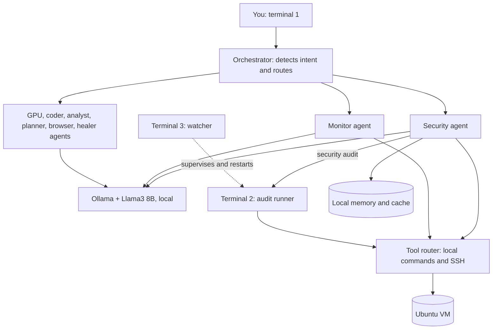

# ECE-Senior-Design-Project-2026

SDP Agentic AI: a free, fully local, private multi-agent AI that analyzes
the security of Linux (Ubuntu) computers over SSH.

Senior Design Project, Electrical and Computer Engineering,
Cal Poly Pomona, Fall 2026.

## Overview
- Runs entirely on your own computer with Ollama and Llama3 8B. No cloud, no paid API.
- Specialized agents (security, monitoring, GPU, code, analysis, planning, browsing, self-healing) share one tool router.
- Security audits map findings to frameworks such as CIS, NIST CSF, ISO 27001, SOC 2, PCI DSS and HIPAA.
- Long audits run in their own terminal, supervised by a watcher terminal that restarts them if they fail.

## What it does
| You type | What happens |
|---|---|
| `run security audit` | Opens two new terminals: one runs the audit, one watches it and restarts it if it fails. Your main terminal stays free. |
| `security audit 192.168.48.130` | Audits a different computer. Results are cached per computer. |
| a plain question, like "what is a firewall" | Answered directly by the local model. |
| a monitoring request | Checks the VM's performance, ports, users and logins over SSH. |
| a GPU request | Samples your GPU and draws a graph of utilization, memory, temperature and power. |
| a coding or analysis request | Routed to the coder or analyst agent. |

Audit reports are framed around a compliance framework (CIS, NIST CSF, ISO 27001,
SOC 2, PCI DSS or HIPAA) chosen for the computer being audited.

## How it works

1. The orchestrator reads your request and picks the right agent.
2. Agents ask the local model to reason and use the tool router to run commands on the VM.
3. For a security audit, the audit runs in its own terminal and a third terminal watches it, restarts it on failure (up to 3 attempts), and reports status.
4. Everything stays on your machine: the model, the memory and the reports.

## Requirements
- Windows 11 with PowerShell
- Python 3.10 or newer
- Ollama with the llama3 model (`ollama pull llama3`)
- plink (from PuTTY) for SSH
- An Ubuntu machine or VM with SSH enabled

## Setup
    cd agent
    .\scripts\setup.ps1 (once)
    .\scripts\launch.ps1

## Documentation
See the `docs/` folder.

## Responsible use
See [SECURITY.md](SECURITY.md).

## License
MIT. See [LICENSE](LICENSE).
