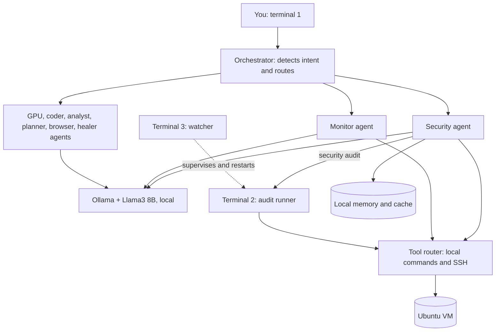

# ECE-Senior-Design-Project-2026

Local AI Agent Using Open-Source LLM: a free, fully local, private multi-agent AI that analyzes
the security of Linux (Ubuntu) computers over SSH.

Senior Design Project, Electrical and Computer Engineering,
Cal Poly Pomona, Fall 2026.

## Overview
- Runs entirely on your own computer with Ollama and Llama3 8B. No cloud, no paid API.
- Specialized agents (security, monitoring, GPU, code, analysis, planning, browsing, self-healing) share one tool router.
- Security audits map findings to frameworks such as CIS, NIST CSF, ISO 27001, SOC 2, PCI DSS and HIPAA.
- Long audits run in their own terminal, supervised by a watcher terminal that restarts them if they fail.

## What it does
| You type | What happens |
|---|---|
| `run security audit` | Opens two new terminals: one runs the audit, one watches it and restarts it if it fails. Your main terminal stays free. |
| `security audit 192.168.1.50` | Audits a different computer. Results are cached per computer. |
| a plain question, like "what is a firewall" | Answered directly by the local model. |
| a monitoring request | Checks the VM's performance, ports, users and logins over SSH. |
| a GPU request | Samples your GPU and draws a graph of utilization, memory, temperature and power. |
| a coding or analysis request | Routed to the coder or analyst agent. |

Audit reports are framed around a compliance framework (CIS, NIST CSF, ISO 27001,
SOC 2, PCI DSS or HIPAA) chosen for the computer being audited.

## How it works

1. The orchestrator reads your request and picks the right agent.
2. Agents ask the local model to reason and use the tool router to run commands on the VM.
3. For a security audit, the audit runs in its own terminal and a third terminal watches it, restarts it on failure (up to 3 attempts), and reports status.
4. Everything stays on your machine: the model, the memory and the reports.

## Getting Started

### What you need
1. A Windows 11 computer. An NVIDIA graphics card helps but isn't required.
2. [Python](https://www.python.org/downloads/) 3.10 or newer. Tick "Add Python to PATH" during install.
3. [Ollama](https://ollama.com), the program that runs the AI model on your computer.
4. [PuTTY](https://www.putty.org) (includes `plink`, which the agent uses for SSH).
5. An Ubuntu computer or virtual machine to audit, such as a free VMware or VirtualBox VM.
   Ubuntu asks you to pick a username and password during install. The agent uses those.
   The security features need this machine. The other features work without one.

## Use your own computer
The agent starts with my test machine saved as its default. Tell it to use yours:

    set vm your-ip user yourusername

For example:

    set vm 192.168.1.50 user ivanSDP

- `your-ip` is the Ubuntu machine's address. Find it by running `hostname -I` on that machine.
- `yourusername` is the name you log in with on that machine.
- The agent remembers this, so you only do it once.
- Type `show vm` at any time to see which computer is selected.

After that, `run security audit` and the monitoring commands use your computer.
The first time, the agent asks for your Ubuntu password and can save it on your computer only.

### Prepare the Ubuntu machine
On the Ubuntu machine, turn on SSH and find its IP address:

    sudo apt install openssh-server
    hostname -I

### Setup
Click the green **Code** button on this page, then **Download ZIP**, and unzip it.
Open PowerShell in the unzipped folder and run:

    ollama pull llama3
    cd jarvis
    Set-ExecutionPolicy -ExecutionPolicy Bypass -Scope Process
    .\scripts\setup.ps1
    .\scripts\launch.ps1

Wait for `[AGENT ONLINE]`, then type a request at the `You >` prompt.
Only need to run .\scripts\setup.ps1 once. The next time you want to launch the agent you can skip .\scripts\setup.ps1.

### Connect to your Ubuntu machine
Connect once so Windows trusts the machine's SSH key. Type `y` when asked, then press Ctrl+C:

    plink -ssh yourusername@your-ip

Then run an audit with your own IP and username:

    security audit your-ip user yourusername

The agent asks for the Ubuntu password (the same one you use to log in to that machine).
It can save it on your computer only. It is never uploaded.

### Troubleshooting
- "No answer on port 22": the Ubuntu machine is off, has a new IP (check with `hostname -I`), or SSH isn't running.
- Type `help` in the agent to see all commands.
## Built With
| | |
|---|---|
| Laptop | ROG Zephyrus G15|
| Graphics card | NVIDIA RTX 3070, 8 GB VRAM  |
| RAM | 16 GB |
| Operating system | Windows 11 |
| AI model | Llama3 8B, served by Ollama |
| Language | Python 3.14 |
| Test target | Ubuntu in a VMware virtual machine (NAT network) |
| SSH | PuTTY plink |
| Python packages | requests, matplotlib, pandas, numpy |
| Storage | SQLite (memory) and local files (cache) |

### Hardware
Tested on the laptop above. Rough guidance for other computers:

| | Minimum | Recommended |
|---|---|---|
| RAM | 8 GB | 16 GB |
| Graphics card | none (runs on the CPU, slower) | NVIDIA with 8 GB VRAM |
| Free disk space | 10 GB | 10 GB |

The Llama3 8B model is about 5 GB to download. With a graphics card
it answers in seconds; on the CPU alone it can take a minute or more.

## Responsible use
See [SECURITY.md](SECURITY.md).

## License
MIT. See [LICENSE](LICENSE).
